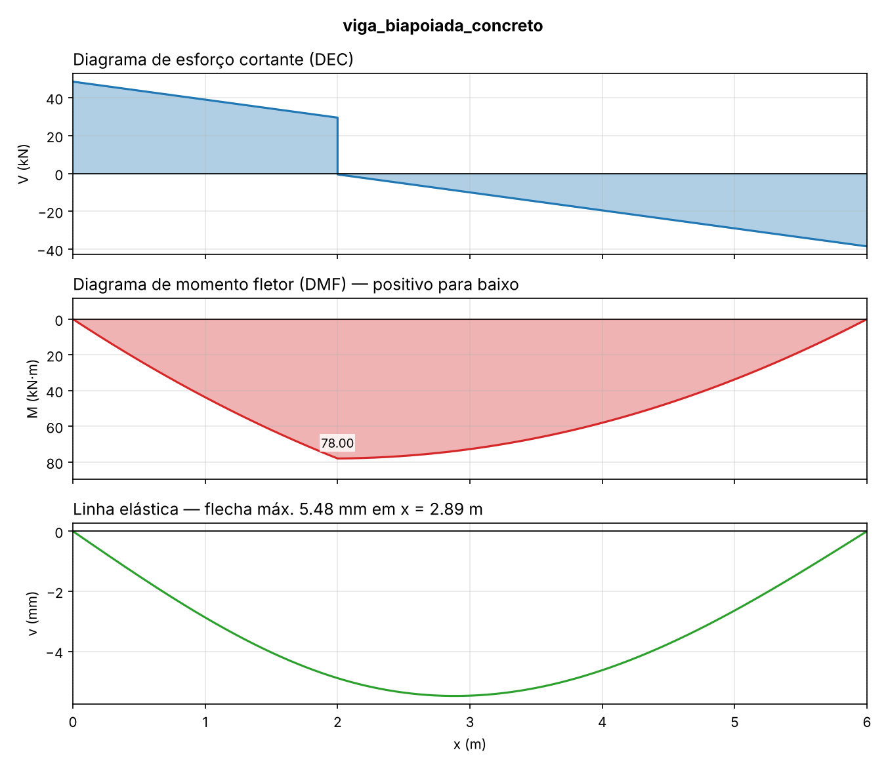
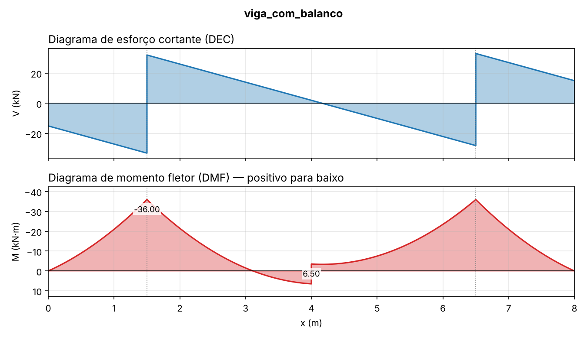

# vigas-isostaticas

[](https://github.com/carlpit/vigas-isostaticas/actions/workflows/ci.yml)


Análise de **vigas isostáticas** em Python: reações de apoio, diagramas de esforço cortante (DEC)
e momento fletor (DMF), linha elástica e verificação da flecha-limite **l/250** da NBR 6118.

Cada resultado é validado nos testes contra as soluções analíticas clássicas de resistência dos
materiais (qL²/8, 5qL⁴/384EI, PL³/3EI, carga triangular…).



## O que faz

- **Apoios:** biapoiada (com ou sem balanços) e engaste à esquerda ou à direita
- **Cargas:** pontual, distribuída uniforme, triangular ou trapezoidal (em qualquer trecho) e
  momento concentrado
- **Esforços:** reações, V(x) e M(x) pelo método das seções, com integração analítica das cargas
  distribuídas, sem aproximar a carga por pontos
- **Linha elástica:** integração numérica de `EI·v'' = M` com as condições de contorno de cada apoio
- **Materiais:** seção retangular (A, I, W), módulo `Ecs` do concreto pela NBR 6118 (fck 20 a 50 MPa)
  e aço (E = 200 GPa)
- **Saídas:** relatório em texto, JSON e diagramas em PNG/SVG/PDF

## Instalação

```bash
git clone https://github.com/carlpit/vigas-isostaticas.git
cd vigas-isostaticas
pip install -e ".[dev]"
```

## Uso pela linha de comando

```bash
vigas exemplos/viga_biapoiada_concreto.json -g viga.png
```

```
Viga biapoiada, L = 6.00 m, 3 carga(s)

Reações:
  R(x=0.00 m) =    48.500 kN
  R(x=6.00 m) =    38.500 kN

Esforços:
  |V| máx =    48.500 kN     em x = 0.000 m
  M+  máx =    78.000 kN·m   em x = 2.000 m
  M−  máx =     0.000 kN·m   em x = 0.000 m

Flecha elástica imediata (sem fissuração/fluência):
  flecha máx = 5.48 mm em x = 2.886 m
  limite l/250 = 24.00 mm → ATENDE
```

### Formato do arquivo JSON

```json
{
  "comprimento": 6.0,
  "apoio": {"tipo": "biapoiada", "a": 0, "b": 6},
  "secao": {"b": 0.20, "h": 0.50},
  "fck_MPa": 25,
  "cargas": [
    {"tipo": "distribuida", "q": 9.5, "x1": 0, "x2": 6},
    {"tipo": "distribuida", "q1": 0, "q2": 5, "x1": 2, "x2": 6},
    {"tipo": "pontual", "P": 30, "x": 2.0},
    {"tipo": "momento", "M": 10, "x": 4}
  ]
}
```

| Campo | Significado |
|---|---|
| `apoio.tipo` | `biapoiada` (com `a` e `b` = posição dos apoios) ou `engaste` (com `lado`: `esquerdo`/`direito`) |
| rigidez | `EI_kNm2`, ou `secao`/`I_m4` com `E_kN_m2`, `fck_MPa` ou `"material": "aco"`. Sem rigidez, a flecha não é calculada |
| `P`, `q` | kN e kN/m, positivos **para baixo** |
| `M` | kN·m, positivo **anti-horário** |

Veja mais exemplos em [`exemplos/`](exemplos/), incluindo viga com balanços e marquise metálica.



## Uso como biblioteca

```python
from vigas import Viga, CargaDistribuida, CargaPontual, SecaoRetangular, modulo_concreto

secao = SecaoRetangular(b=0.20, h=0.50)
EI = modulo_concreto(fck_mpa=25) * secao.inercia

viga = Viga(6.0, "biapoiada", EI=EI).adicionar(
    CargaDistribuida.uniforme(q=9.5, x1=0, x2=6),
    CargaPontual(P=30, x=2.0),
)
res = viga.analisar()
print(res.reacoes.forcas)   # {0.0: 48.5, 6.0: 38.5}
print(res.M_max)            # (78.0, 2.0)
print(res.flecha_max)       # (0.00548..., 2.886...)  metros, positivo para baixo
```

## Convenções e hipóteses

- Unidades: **kN, m, kN·m**; E em kN/m² (1 GPa = 10⁶ kN/m²).
- Cortante positivo: resultante à esquerda da seção para cima. Momento positivo: tração embaixo.
  O DMF é desenhado com o positivo **para baixo**, como é costume no Brasil.
- Teoria de Euler-Bernoulli, material elástico linear, EI constante ao longo da viga.
- A flecha calculada é a **imediata elástica**. Para concreto armado, a verificação do ELS-DEF
  exige considerar fissuração (inércia equivalente de Branson) e fluência (αf), como prevê a
  NBR 6118. Isso está no roadmap.
- Limite l/250: em balanços, o vão de referência é o dobro do comprimento do balanço.

> Ferramenta de estudo e pré-dimensionamento. Não substitui o projeto estrutural assinado por
> profissional habilitado, com ART.

## Validação

`pytest` verifica, entre outros:

| Caso | Referência |
|---|---|
| Biapoiada, carga uniforme | M = qL²/8, f = 5qL⁴/384EI |
| Biapoiada, carga pontual | M = Pab/L, f = PL³/48EI (centrada) |
| Biapoiada, carga triangular | M = qL²/(9√3) em x = L/√3, f = 0,00652 qL⁴/EI |
| Balanço, carga na ponta | M = −PL, f = PL³/3EI |
| Balanço, carga uniforme | M = −qL²/2, f = qL⁴/8EI |
| Momento concentrado | salto de M no DMF igual ao momento aplicado |
| Qualquer carregamento | ΣF = 0, ΣM = 0, dV/dx = −q |
| Concreto | Ecs da Tabela 8.1 da NBR 6118 (C20 a C50) |

## Roadmap

- [ ] Inércia equivalente de Branson e flecha diferida (NBR 6118, 17.3.2)
- [ ] Dimensionamento à flexão (As) e ao cisalhamento (estribos)
- [ ] Vigas contínuas (hiperestáticas) pelo método da rigidez
- [ ] Interface web com Streamlit

## Licença

MIT
